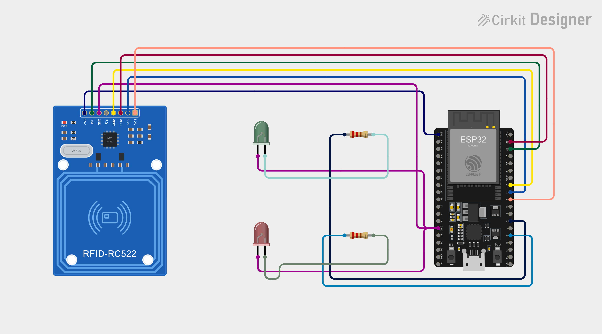
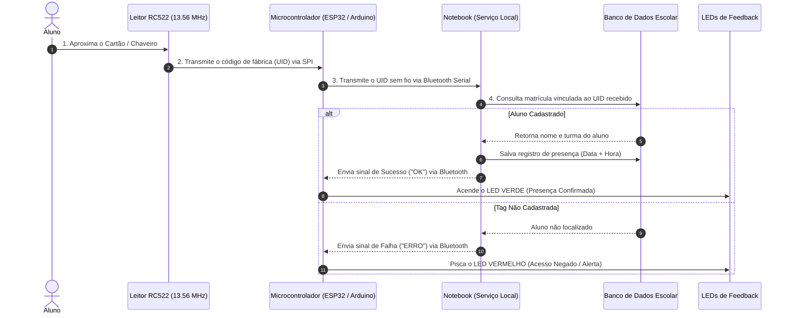

# 📡 RFID Presence Tracker (Chamada Inteligente via NFC + Bluetooth)

Sistema automatizado de controle de presença escolar e registro de acesso em tempo real, combinando leitura de identificadores físicos (NFC/RFID), transmissão sem fio via **Bluetooth** e feedback visual imediato através de **LEDs indicativos**.

---

## 🖼️ Esquema Visual do Circuito



---

## 💡 A Ideia do Projeto

Em ambientes acadêmicos e corporativos, a chamada manual consome tempo de aula e está sujeita a fraudes ou erros de anotação. A proposta deste projeto é substituir a lista de chamada tradicional por um **dispositivo inteligente e portátil de presença**:

1. **Identificação Física Individual:** Cada aluno possui um chaveiro ou cartão NFC institucional.
2. **Leitura por Indução:** O aluno apenas aproxima sua tag do leitor na entrada da sala ou bancada.
3. **Ponte Sem Fio (Bluetooth):** O microcontrolador envia imediatamente a identificação da tag para o notebook do professor/sala via Bluetooth, sem necessidade de cabeamento de rede ou Wi-Fi complexo.
4. **Validação e Persistência:** Um serviço no computador recebe o código, pesquisa no banco de dados e registra a presença com carimbo de data e hora.
5. **Retorno Visual Instantâneo:** O microcontrolador recebe a resposta do computador e sinaliza aos olhos do aluno:
   * 🟢 **LED Verde:** Aluno identificado e presença confirmada.
   * 🔴 **LED Vermelho:** Aluno não encontrado, tag não cadastrada ou erro de acesso.

---

## 🔄 Fluxo Completo de Comunicação



---

## 🧩 Papel de Cada Componente

* **Módulo RFID/NFC RC522 (13.56 MHz):** Emite um campo eletromagnético. Quando o chaveiro ou cartão se aproxima, a tag é energizada por indução e o leitor captura seu identificador único (**UID**).
* **Microcontrolador (ESP32 ou Arduino):** O cérebro do circuito. Gerencia a leitura do módulo via protocolo SPI, envia os dados via Bluetooth para o notebook e aciona os LEDs de acordo com o retorno recebido.
* **Bluetooth (Comunicação Sem Fio):** Cria uma conexão serial transparente com o notebook, permitindo que o leitor fique na mesa ou na porta sem fios conectados ao computador.
* **LED Verde + Resistor de 220Ω:** Validação positiva de presença para o aluno.
* **LED Vermelho + Resistor de 220Ω:** Alerta visual imediato de recusa ou falha de comunicação.
* **Notebook + Banco de Dados:** Central de inteligência que armazena as turmas, horários e histórico de presenças.

---

## 🔌 Mapeamento das Conexões Físicas (Pinout)

### Leitor RC522 ao Microcontrolador:
| Pino no RC522 | Função | Conexão ESP32 | Conexão Arduino Uno (com HC-05) |
| :--- | :--- | :---: | :---: |
| **VCC (3.3V)** | Alimentação principal *(estrita)* | **3V3** | **3.3V** |
| **GND** | Aterramento comum | **GND** | **GND** |
| **RST** | Reset do leitor | **GPIO 22** | **Pino 9** |
| **MISO** | Saída de dados (Master In Slave Out) | **GPIO 19** | **Pino 12** |
| **MOSI** | Entrada de dados (Master Out Slave In) | **GPIO 23** | **Pino 11** |
| **SCK** | Sinal de sincronismo de clock | **GPIO 18** | **Pino 13** |
| **SDA (SS)** | Linha de seleção do chip (Chip Select) | **GPIO 5** | **Pino 10** |

### LEDs de Feedback Visual:
| LED | Função | Conexão ESP32 | Conexão Arduino Uno |
| :--- | :--- | :---: | :---: |
| 🟢 **LED Verde** | Confirmação de Presença | **GPIO 4** (com resistor 220Ω) | **Pino 7** (com resistor 220Ω) |
| 🔴 **LED Vermelho** | Alerta / Não Cadastrado | **GPIO 2** (com resistor 220Ω) | **Pino 6** (com resistor 220Ω) |

---

## 📁 Estrutura do Repositório

```text
rfid-presence-tracker/
├── assets/
│   └── circuit_image.png   # Imagem ilustrativa do circuito e montagem
├── firmware/
│   └── firmware.ino        # Código-fonte do microcontrolador (em desenvolvimento)
├── server/
│   └── server.py           # Serviço receptor do notebook e banco de dados (em desenvolvimento)
├── .gitignore              # Arquivos temporários ignorados pelo Git
└── README.md               # Documentação conceitual e técnica do projeto
```

---

## 📄 Licença
Distribuído sob a licença MIT. Livre para uso acadêmico e desenvolvimento de projetos de Internet das Coisas (IoT).
